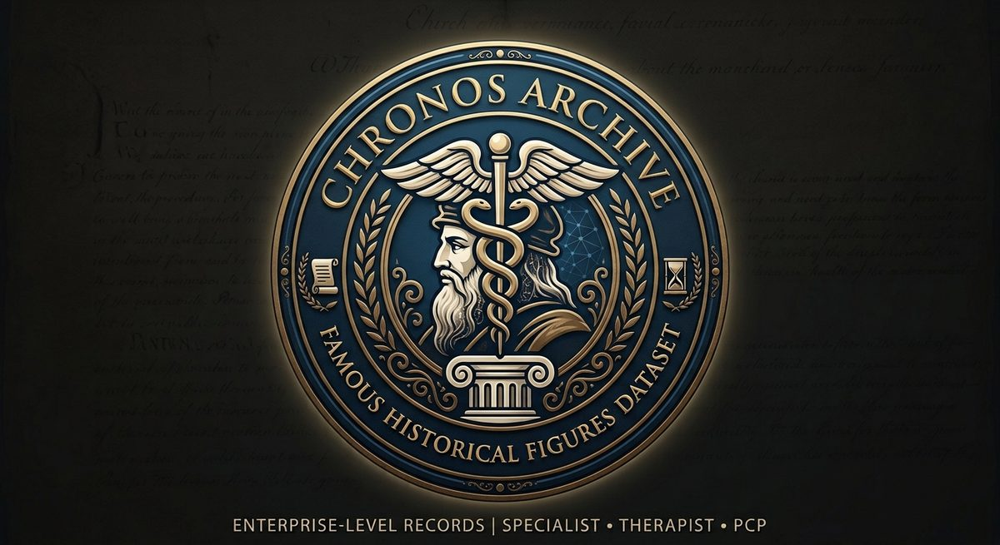

<p align="center"></p>

# The Human Record

The Human Record, published as **Chronos Archive**, is a public dataset of synthetic modern clinical records for deceased historical figures. Each record imagines the person as a present-day patient: a short care episode with visits, results, notes, and C-CDA and FHIR files. Historical evidence, retrospective interpretation, and invented clinical content are kept apart, and every clinical statement is graded and linked to its sources. Original archetypes are planned.

**[Browse all records](https://patrickrutledge.github.io/chronic_histories/)**: 153 draft records. None has completed review yet.

> SYNTHETIC RECORD, NOT A REAL MEDICAL RECORD
>
> The visits, results, medications and notes are invented for teaching. They are not medical advice and not a claim about what any person had. Every generated file carries this banner.

## Give feedback

Clinicians, historians, and anyone else can help, with no code and no file editing:

- **Report a problem.** Every record page has a *Report a problem* button. It opens a short form with the case ID filled in. Each report becomes a tracked issue. A source for the correction helps.
- **Comment.** Every record page has a comment thread at the bottom.
- **Open questions.** Judgment calls still open for each record are listed as issues labeled [`clinical-review`](https://github.com/PatrickRutledge/chronic_histories/issues?q=is%3Aissue+label%3Aclinical-review).

Both need a free GitHub account.

## Support

Chronos Archive is built and maintained independently. If it is useful to you, you can [support it on Buy Me a Coffee](https://buymeacoffee.com/patrickrutledge).

## Repository structure

- `schema/` — canonical JSON Schema
- `docs/` — dataset policies and technical decisions, including [conformance validation](docs/validation.md)
- `pilots/` — one canonical case folder per pilot
- `cases/` — one canonical case folder per batch record, built the same way as the pilots
- `scripts/` — deterministic generators and validators
- `outputs/` — editorial workbook outputs
- `assets/` — the Chronos Archive logo and site images
- `index.html` — the main page: every record with links to its record page, review checklist, sources, C-CDA, FHIR and review issue, a search box, and a per-browser "verified" checkbox; regenerated by every build. Online at https://patrickrutledge.github.io/chronic_histories/ (republished on every push to main)
- `manifest.csv` — one row per pilot and batch case, regenerated by every build
- [docs/datasheet.md](docs/datasheet.md) — scope, composition, intended uses, and known biases
- [CHANGELOG.md](CHANGELOG.md) — release history

See [STATUS.md](STATUS.md) for the current decisions, completed milestones, validation results, limitations, and continuation plan.

## Evidence grades

- `D` — documented in a primary or reliable source
- `R` — retrospective clinical or historical interpretation
- `S` — synthetic content generated for the teaching record

## Build and check

```powershell
pwsh -File scripts/build.ps1                  # every pilot, batch record and test fixture
pwsh -File scripts/build.ps1 -Conformance     # also formal C-CDA and US Core validation
pwsh -File scripts/run_controls.ps1           # confirm the checks still catch known defects
```

The build stops at the first failure. It deletes earlier outputs before generating, so a failed generator cannot leave stale files to be checked. It records a hash manifest, and the local checks reject outputs that do not match the current `case.json`. Do not edit generated files by hand.

The generators write an HTML review page, a FHIR R4 collection bundle, a C-CDA R2.1 CCD, C-CDA note documents (a History and Physical, a Progress Note per follow-up visit, and a Referral and Consultation Note where the plan includes one), nine to twelve case-driven supporting notes in Markdown, a review checklist, and a provenance CSV under the case's `generated/` directory. Supporting notes are rendered from the canonical case rather than embedded pilot prose.

A case is released only when its clinical, provenance, and safe-messaging reviews have passed; the build rejects an approved case that lacks any of them. No case is released yet. See [docs/validation.md](docs/validation.md) for formal C-CDA R2.1 and US Core validation and for what a pass does and does not establish.

## Contributing

See [CONTRIBUTING.md](CONTRIBUTING.md) for evidence, sourcing, and safety rules, and [CLA.md](CLA.md) for the contributor license agreement.

## License

- Data and documentation: [CC BY-NC 4.0](LICENSE-DATA). Free for non-commercial use with attribution.
- Code and schema: [MIT](LICENSE-CODE).
- Commercial use of the data needs a license from Aether Forge. See [COMMERCIAL-USE.md](COMMERCIAL-USE.md).
- Terminologies and cited sources stay under their owners' terms. See [NOTICE.md](NOTICE.md).
